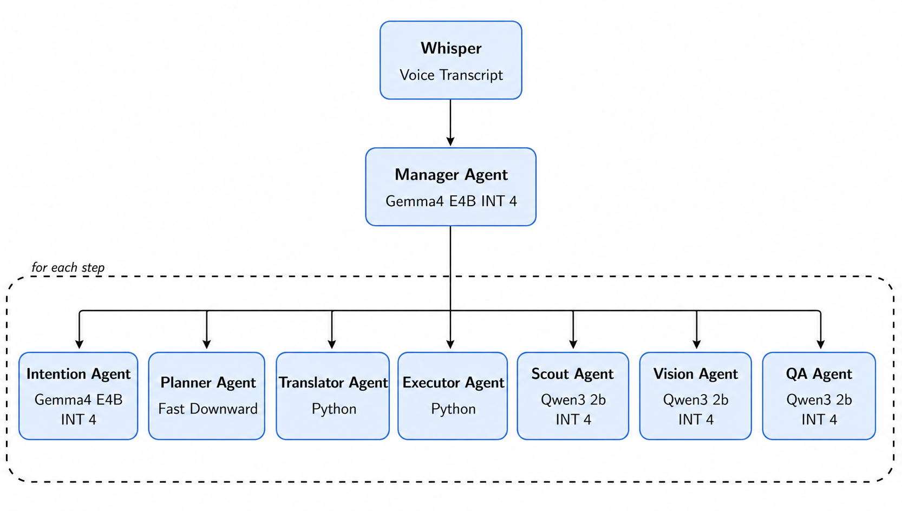

<div align="center">

# Autopilot

### On-device AI desktop agent for hands-free, accessible Windows automation

Say what you want done. Autopilot plans it, does it on screen and checks that it worked,<br>
**fully autonomous, fully local, with no data leaving your computer.**


-8A2BE2)


[Report (PDF)](Docs/Autopilot_Report.pdf) · [Presentation (PDF)](Docs/Autopilot_Presentation.pdf) · [How it works](#how-it-works) · [Results](#results) · [Getting started](#getting-started)

</div>

---

## Why Autopilot

People with limited motor function often depend on someone else, or on long chains of voice commands, to use a computer. Cloud "computer-use" agents can help, but they send screenshots of your desktop to remote servers and still make planning mistakes.

Autopilot takes a different route. From **one spoken sentence** it completes the whole task on the real Windows interface, **without any further keyboard, mouse or voice input**, and **everything runs on your own machine**: speech recognition, language understanding, planning, vision and execution. No internet connection, no data exposure.

It **combines deterministic and non-deterministic methods**: small local language and vision models understand the request and find things on screen, while a classical planner (PDDL with Fast Downward) decides the exact sequence of actions. The plan is deterministic and explainable, and a final check confirms the result.

> Final Degree Project in Computer Engineering (Research Track), Universidad Francisco de Vitoria, Madrid, 2026. Graded **10/10**.

## How it works

<div align="center">

</div>

1. **Listen.** Whisper (`faster-whisper`, local GPU) transcribes the spoken command.
2. **Understand.** The **Intention Agent** turns free-form speech into a structured task: which template (open, write, format, create, delete, search, copy/paste) and which parameters (file, folder, text...).
3. **Plan.** The **Planner Agent** writes a PDDL problem and **Fast Downward** solves it, producing a short, optimal and repeatable plan.
4. **Translate.** The **Translator** turns each PDDL action into a concrete GUI step.
5. **See.** For every step, the **Scout Agent** checks whether the target is visible and the **Vision Agent** finds its exact pixel coordinates in a screenshot.
6. **Act.** The **Executor** clicks, types and presses shortcuts with PyAutoGUI.
7. **Verify.** The **QA Agent** looks at the final screen and confirms the task really finished.

A **Manager Agent** (a local LLM using tool-calling, built on CrewAI) orchestrates the whole loop. It never touches the GUI itself: it delegates every action to the specialised agents above.

| Component | Runs on | Model / tool |
|---|---|---|
| Speech-to-text | Host GPU | Whisper `small` (faster-whisper) |
| Manager and Intention agents | Ollama (Docker) | Gemma 4 E4B, 4-bit |
| Scout, Vision and QA agents | Ollama (Docker) | Qwen3-VL 2B, 4-bit |
| Planner | Docker service | Fast Downward (PDDL) |
| Translator and Executor | Host | Python (deterministic), PyAutoGUI |

## What it can do

| Task template | Example command |
|---|---|
| Navigate and open files | *"Open report.pdf in Documents, TFG, Docs"* |
| Write a note | *"Take a quick note saying I have a meeting tomorrow at 3 pm"* |
| Change text format | *"Open my file.odt and make 'Hello' bold"* |
| Create files or folders | *"Create a folder named Projects in Documents"* |
| Delete text | *"Open my file and delete 'old paragraph'"* |
| Search text | *"Open my file and search for 'Introduction'"* |
| Copy and paste files | *"Copy report.docx from Downloads to Documents"* |

## Results

Evaluated on **7 task templates × 3 runs (21 runs)** against five alternatives: Windows Voice Access, OpenClaw and three cloud computer-use agents.

| Metric | Autopilot |
|---|---|
| Task success rate | **100%** (21/21) |
| Planning errors | **0** |
| Tool hallucinations | **0** |
| Data exposure | **None** (everything local) |
| Step-to-step variability | **0** (same plan every run) |
| Average steps per task | 4.6 |
| Step accuracy | 92.5% |

Among the systems that can finish a task **autonomously from a single command**, Autopilot is the only one that combines full task success with **zero data exposure**: the cloud agents send your screen to remote servers and made planning errors, and the open-source alternative completed none of the tasks. Voice Access also succeeds, but only when the user dictates every step one by one.

The trade-off is speed (about 110 s per task on consumer hardware) and scope: reliability is guaranteed inside the seven PDDL task templates. Full tables, model selection experiments and resource usage are in the [report](Docs/Autopilot_Report.pdf), and the raw evidence (screenshots and logs for every run of every system) is in `Code/competitors/` and `Code/logs/`.

## Getting started

> **Windows only.** Autopilot drives the real Windows interface (taskbar, Start menu, File Explorer, Win-key search), so it is only guaranteed to work on Windows.

### Requirements

- Windows 10/11 desktop
- Python 3.10+ (conda or venv)
- Docker Desktop, running
- NVIDIA GPU with CUDA (for local Whisper; a CPU fallback is possible, see below)
- A microphone

Two parts run on the host and not in Docker on purpose: the agent pipeline needs direct access to the Windows GUI, and Whisper needs direct access to the microphone.

### Install

```bash
git clone https://github.com/gontorrs/autopilot.git
cd autopilot

# Python environment
conda create -n autopilot python=3.12
conda activate autopilot          # or: python -m venv .venv && .venv\Scripts\activate
pip install -r Code/requirements.txt

# Local models (one time, stored in a Docker volume)
docker compose up -d ollama
docker exec -it ollama ollama pull gemma4:e4b-it-q4_K_M
docker exec -it ollama ollama pull qwen3-vl:2b-instruct-q4_K_M
```

The Whisper `small` model (~460 MB) downloads automatically on the first run. To fetch it in advance:

```bash
cd Code
python -c "from faster_whisper import WhisperModel; WhisperModel('small', device='cuda', compute_type='float16', download_root='./models/whisper')"
```

No NVIDIA GPU? In `Code/voice/whisper.py` change `device="cuda"` to `device="cpu"` and `compute_type="float16"` to `compute_type="int8"` (slower transcription).

### Run

```bash
python run.py
```

`run.py` starts the Ollama and Fast Downward containers, launches the agent on the host and shuts everything down cleanly on exit (or `Ctrl+C`).

**Minimise the terminal after launching:** Autopilot moves your mouse and types on your keyboard, so do not touch the desktop while it works.

### Configure

The task to run and the models used are set in `Code/main.py`:

```python
user_input = "Create a folder named \"Projects\" in the Documents folder."

planner_model   = model_dict['e4bk']       # Manager LLM
vlm_model       = model_dict['qwen2k-vl']  # Scout / Vision / QA
intention_model = model_dict['e4bk']      # Intention classifier
```

## Repository structure

```
├── run.py                  # Entry point: starts Docker services and the agent
├── docker-compose.yaml     # Ollama + Fast Downward planner services
├── docker/planner/         # Dockerfile of the planner service
├── Code/
│   ├── main.py             # Core application
│   ├── crew/               # Agents: manager, intention, planner, translator, executor, VLM agents
│   ├── tools/              # CrewAI tools and VLM prompts
│   ├── pddl/               # PDDL domain for GUI actions and example problems
│   ├── voice/              # Local speech-to-text (Whisper)
│   ├── competitors/        # Evidence of every evaluated alternative, per task and run
│   └── logs/               # Logs and screenshots of Autopilot's evaluation runs
├── assets/                 # Images used in this README
└── Docs/
    ├── Autopilot_Report.pdf        # Final thesis report
    ├── Autopilot_Presentation.pdf  # Defence presentation
    └── Tabla_Experimentos_FINAL.xlsx   # Raw experiment data
```

## Tech stack

CrewAI · Ollama · Gemma 4 · Qwen3-VL · faster-whisper · Fast Downward (PDDL) · PyAutoGUI · Docker · Python

## Author

**Gonzalo Torras Serrano** · [gontorras.cloud](https://gontorras.cloud) · [LinkedIn](https://www.linkedin.com/in/gonzalo-torras/) · [GitHub](https://github.com/gontorrs)

Final Degree Project supervised by **Moisés Martínez Muñoz**, Universidad Francisco de Vitoria (Madrid), 2026.

If you use this work, please cite the thesis report in `Docs/`.
